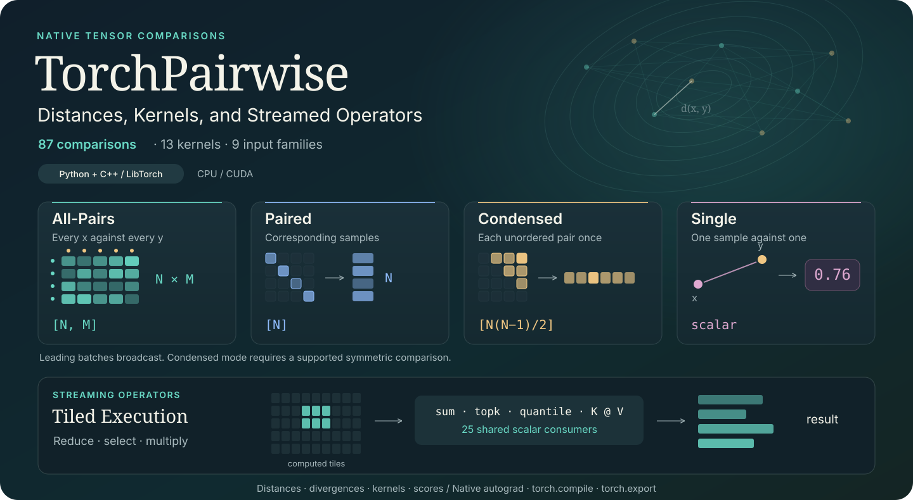

# <picture><source media="(prefers-color-scheme: dark)" srcset="docs/assets/logo-dark.svg" /></picture> TorchPairwise

[](https://github.com/inspiros/torchpairwise/actions/workflows/build_wheels.yml)
[](https://inspiros.github.io/torchpairwise/)
[](https://pypi.org/project/torchpairwise/)
[](https://pepy.tech/project/torchpairwise)
[](LICENSE.txt)
[](https://doi.org/10.5281/zenodo.14699363)

<p align="center">
  
</p>

Compare tensors with one API, whether a sample is a vector, a point cloud, an
image, a waveform or a distribution. Return the comparisons themselves, or
**stream the result your algorithm needs** through reductions, neighbor
selection and matrix products. Python and standalone C++/LibTorch share native
forward and first-backward implementations on CPU and CUDA.

<p align="center">
  <a href="https://inspiros.github.io/torchpairwise/"></a>
  <a href="https://pypi.org/project/torchpairwise/"></a>
</p>

[Comparison modes](docs/dispatchers.md) · [Streaming operators](docs/operators.md) ·
[C++ / LibTorch](docs/native-api.md) · [Build from source](docs/building.md) ·
[Full comparison catalog](#implemented-comparisons)

The [documentation website](https://inspiros.github.io/torchpairwise/) organizes
metrics by equation, input/output shape and comparison mode, with Python/C++
examples. [Local preview and website builds](docs/site/README.md) use mdBook.

| Choose your result | API | What it produces |
| --- | --- | --- |
| Every sample pair | `compare(X, Y, mode="all_pairs", ...)` | `[..., N, M]` |
| Corresponding samples | `compare(X, Y, mode="paired", ...)` | `[..., N]` |
| Each unordered self pair once | `compare(X, mode="condensed", ...)` | `[..., N*(N-1)//2]`, for supported symmetric comparisons |
| One sample pair per batch | `compare(x, y, mode="single", ...)` | `[...]`; a scalar without batches |
| A reduced, selected or multiplied result | `tp.lazy(...).sum(...)`, `.topk(...)`, `.matmul(V)` | The requested result, without retaining the full generated comparison matrix |

The catalog contains **87 comparison entries**, including **13 kernels**, across
**9 input families**. Scalar streaming operators share **25 consumers**, with
products, selection, basic reductions and statistics. Catalog entries include
mathematical synonyms; counts describe the API rather than distinct formulas.
Feature residuals and image maps also have streamed event-axis reductions.

> **Version 1.0.** This README describes the 1.0 API. If PyPI still offers
> 0.3, build from source to use the new features. Native wheels require their
> matching PyTorch minor. See [source builds](docs/building.md),
> [migration](docs/migration.md) and [release notes](CHANGELOG.md).

## Quick Start: Four Modes, One Selector

```python
import torch
import torchpairwise as tp

X = torch.randn(20, 6)
Y = torch.randn(30, 6)
metric = "sqeuclidean"

matrix = tp.compare(X, Y, metric=metric)                       # [20, 30]
aligned = tp.compare(X, Y[:20], metric=metric, mode="paired")  # [20]
unordered = tp.compare(X, metric=metric, mode="condensed")     # [190]
value = tp.compare(X[0], Y[0], metric=metric, mode="single")   # scalar
```

**`single` is a mode of `compare`.** `single_comparison(x, y, metric=...)` is
an optional shorthand for that same call. Inputs omit the collection's N/M axis:
a vector is `[D]`, a cloud `[P,D]`, an image `[C,H,W]`, and a Gaussian is
`(mean[D], covariance[D,D])`. Leading batches broadcast in every mode; for
example, single mode on `[B,D]` vectors returns `[B]` rather than `[B,B]`.
Use `list_comparisons()` to discover names, roles, layouts and supported modes.

Most numeric comparisons support first input gradients; Boolean/equality inputs
are nondifferentiable. Feature weights can have gradients where their formulas
permit. Autocast and compile/export support follow each operation's contract;
see [API contracts](docs/api-contracts.md) and [PyTorch integration](docs/pytorch-integration.md).

## Keep the Result, Stream the Comparisons

Use `tp.lazy` to bind comparisons and their consumers. Custom metric and
encoder factories can also supply comparisons to `tp.lazy`.

Bind a logical comparison matrix, then ask for what you need. A consumer computes
sample tiles and combines their results; it does not retain the full generated
N-by-M matrix. The same source can feed reductions, selections or products:

```python
V = torch.randn(30, 4)
A = tp.lazy(X, Y, metric="sqeuclidean", chunk_size=16)

nearest = A.topk(3, largest=False)        # values / indices: [20, 3]
row_spread = A.std(dim=-1, correction=0)  # [20]
smoothed = (-0.5 * A).softmax_matmul(V)   # [20, 4]

K = tp.lazy(X, Y, metric="rbf", gamma=0.2)
features = K.matmul(V)  # [20, 4], streamed K @ V
```

Each consumer recomputes the source tiles; binding an operator does not cache
a matrix. Inputs, prepared features, outputs and gradient buffers still occupy
memory, and some consumers need additional workspace. Chunk widths control
sample or feature tiles, not a total memory budget. They accept any positive
Python integer up to `2**63 - 1`, including non-powers of two. See the
[streaming guide](docs/operators.md), [selection/statistics](docs/operator-statistics.md)
and [reproducible benchmarks](docs/benchmarking.md).
For complete consumers, see the [k-NN regression, kernel smoothing and attention
examples](examples/streaming_ml.py), each checked against its dense formula.

The same comparison selector is available in standalone C++:

```cpp
#include <torchpairwise.h>

namespace tp = torchpairwise::ops;
auto matrix = tp::compare(X, Y, "sqeuclidean", "all_pairs");
auto value = tp::compare(x, y, "sqeuclidean", "single");
```

See the [native API](docs/native-api.md) and [CMake package](docs/cmake.md) for
headers, linking, structured inputs, options and native operator consumers.

## Implemented Comparisons

Function names below are public exports of `torchpairwise`. Distances,
divergences, kernels, and quality scores retain their own definitions: a
symmetric comparison is not necessarily a triangle-inequality metric, and an
image similarity score is not automatically a positive-semidefinite kernel.
Aliases are identified explicitly rather than counted as additional formulas.

### Vector Geometry and Numeric Data

Inputs normally have shape `[..., N, D]` and `[..., M, D]`.

| Comparison | Public function | Parameters / convention |
| --- | --- | --- |
| Euclidean | `euclidean_distances` | Optional feature weights `w` |
| Squared Euclidean | `sqeuclidean_distances` | Optional `w` |
| Manhattan | `manhattan_distances` | Optional `w` |
| Minkowski | `minkowski_distances` | Power `p`, optional `w` |
| Weighted Minkowski | `wminkowski_distances` | Legacy weighted-Lp entry point; `p`, `w` |
| Chebyshev | `chebyshev_distances` | Optional `w` selects positive-weight coordinates |
| Standardized Euclidean | `seuclidean_distances` | Variances `V` |
| Mahalanobis | `mahalanobis_distances` | Inverse covariance `VI` |
| Cosine distance | `cosine_distances` | Optional `w` |
| Correlation distance | `correlation_distances` | Optional `w` |
| Angular | `angular_distances` | Radians; nonzero vectors |
| Canberra | `canberra_distances` | Optional `w` |
| Bray-Curtis | `braycurtis_distances` | Optional `w` |
| Lorentzian | `lorentzian_distances` | Sum of log1p absolute differences |
| Haversine | `haversine_distances` | Latitude/longitude in radians, `D=2` |
| Signal-to-noise ratio | `snr_distances` | Directed comparison |
| NaN-aware Euclidean | `nan_euclidean_distances` | Missing-feature rescaling; optional `squared` |

| Alias | Equivalent entry point |
| --- | --- |
| `l1_distances`, `cityblock_distances` | `manhattan_distances` |
| `l2_distances` | `euclidean_distances` |
| `lp_distances` | `minkowski_distances` |
| `linf_distances` | `chebyshev_distances` |

See [feature weighting](docs/weighted-distances.md),
[angular and related distances](docs/additional-vector-distances.md), and
[missing-data comparisons](docs/missing-and-ordered-data.md).

### Boolean and Equality Comparisons

Hamming compares equality of numeric or Boolean coordinates. The other entries
use Boolean vectors. Each accepts optional feature weights `w`; input
comparisons themselves have no derivatives. Undefined empty-support cases and
weight-gradient conventions are described in the
[contracts](docs/api-contracts.md) and [weighting guide](docs/weighted-distances.md).

| Comparison | Public function |
| --- | --- |
| Hamming | `hamming_distances` |
| Jaccard | `jaccard_distances` |
| Dice | `dice_distances` |
| Yule | `yule_distances` |
| Rogers-Tanimoto | `rogerstanimoto_distances` |
| Russell-Rao | `russellrao_distances` |
| Sokal-Michener | `sokalmichener_distances` |
| Sokal-Sneath | `sokalsneath_distances` |
| Kulczynski1 | `kulczynski1_distances` |
| Legacy Kulsinski | `kulsinski_distances` |

### Histograms, Probabilities, and Compositions

These use one dense vector per sample. The normalization/domain column matters:
raw masses, probability distributions, and positive compositions have different
meanings. Domain and zero/infinite-support gradient conventions are in the
[histogram](docs/histograms.md), [probability](docs/probability-divergences.md),
and [composition](docs/distribution-comparisons.md) guides.

| Comparison | Public function | Normalization / domain |
| --- | --- | --- |
| Hellinger | `hellinger_distances` | Independently normalized nonnegative positive-mass rows |
| Bhattacharyya distance | `bhattacharyya_distances` | Normalized; negative log coefficient |
| Total variation | `total_variation_distances` | Normalized; half L1 |
| Fisher-Rao | `fisher_rao_distances` | Normalized; twice the square-root probability angle |
| Jensen-Shannon distance | `jensenshannon_distances` | Normalized; rooted divergence; optional log `base` |
| KL divergence | `kl_divergences` | Normalized; directed; optional `base` |
| Symmetric KL / Jeffreys | `symmetric_kl_divergences` | Normalized; sum of both KL directions |
| Rényi divergence | `renyi_divergences` | Normalized; positive finite `alpha`, KL at one |
| Pearson chi-square | `pearson_chi2_divergences` | Normalized; second operand in denominator |
| Neyman chi-square | `neyman_chi2_divergences` | Normalized; first operand in denominator |
| Triangular discrimination | `triangular_discrimination_distances` | Normalized; no half factor |
| Itakura-Saito | `itakura_saito_divergences` | Raw strictly positive spectra |
| Aitchison | `aitchison_distances` | Strictly positive compositions; centered log-ratios |
| Clark | `clark_distances` | Raw nonnegative vectors; coordinate-wise relative differences |
| Soergel / Ružička | `soergel_distances`, `ruzicka_distances` | Same continuous min/max Jaccard formula for raw nonnegative vectors |
| Continuous Jaccard alias | `continuous_jaccard_distances` | Alias of `ruzicka_distances`; distinct from Boolean Jaccard |
| Shared-grid 1D Wasserstein | `wasserstein_1d_distances` | Normalized histogram masses; optional ordered `bin_positions` |

### Point Sets and Empirical Distributions

A sample is a collection of points: standard inputs are `[..., N, P, C]` and
`[..., M, Q, C]`. Spatial feature axes, channel-first layouts, prefix lengths,
and sample chunking follow the [point-set guide](docs/pointsets.md).

| Comparison | Public function | Convention |
| --- | --- | --- |
| Directed Hausdorff | `directed_hausdorff_distances` | Returns distances and point witnesses; asymmetric |
| Symmetric Hausdorff | `hausdorff_distances` | Maximum of the two directed Euclidean distances |
| Chamfer | `chamfer_distances` | Sum of directional mean nearest-point distances; optional `squared` |
| Exact multidimensional Wasserstein | `wasserstein_distances` | Uniform empirical W1/W2; `p=1` or `2`; CPU-coordinated solver, including CUDA inputs |
| Sliced Wasserstein | `sliced_wasserstein_distances` | Uniform projected W1/W2; explicit shared `projections` |
| Sinkhorn divergence | `sinkhorn_divergences` | Debiased regularized transport estimate; fixed iteration budget |
| Energy distance | `energy_distances` | Uniform empirical V statistic; rooted by default |
| Kernel MMD | `mmd_distances` | Biased V statistic; 11 named registry kernels plus historical Euclidean Laplacian; polynomial options supported; rooted by default |
| MMD estimates / KID statistic | `mmd_statistics` | Signed biased/unbiased estimates; selectable kernels including cubic polynomial on supplied features; no learned model |

Transport compares uniform point masses; it is separate from histogram-bin
`wasserstein_1d_distances`. Exact transport is intended for small clouds. Sliced
Wasserstein and finite-iteration Sinkhorn retain their distinct approximation
and gradient contracts. See [transport](docs/transport.md),
[distribution comparisons](docs/distribution-comparisons.md), and the
[example](examples/metric_catalog.py).

### Gaussian Distributions and Covariance Geometry

These standalone structured APIs use explicit means/covariances or covariance
matrices. They are separate from the vector `cdist`/`pdist` registry. Each row
has all three output modes; `squared=True` selects the unrooted quantity.

| Comparison | All-pairs function | Paired function | Condensed function |
| --- | --- | --- | --- |
| Gaussian Wasserstein / Bures W2 | `gaussian_wasserstein_distances` | `paired_gaussian_wasserstein_distances` | `condensed_gaussian_wasserstein_distances` |
| Log-Euclidean covariance distance | `log_euclidean_distances` | `paired_log_euclidean_distances` | `condensed_log_euclidean_distances` |
| Affine-invariant Riemannian covariance distance | `affine_invariant_distances` | `paired_affine_invariant_distances` | `condensed_affine_invariant_distances` |
| Rooted Stein / Jensen-Bregman LogDet | `stein_distances` | `paired_stein_distances` | `condensed_stein_distances` |

Gaussian W2 accepts means `[..., N, D]` and positive-semidefinite covariances
`[..., N, D, D]`. The other three require strictly positive-definite covariances.
See [Gaussian comparisons](docs/distribution-comparisons.md) and
[covariance geometry](docs/covariance-distances.md) for tolerances, singular
boundaries, memory, and first-gradient support.

### Gaussian Mixtures and Splat Geometry

Each sample is a weighted mixture: means `[...,N,K,D]`, covariances
`[...,N,K,D,D]` and weights `[...,N,K]`. Explicit masses are normalized per
sample; prefix lengths ignore padding. Density comparisons require SPD
covariances; Gaussian-component transport accepts PSD covariances.

| Comparison | All-pairs function | Paired function | Condensed function |
| --- | --- | --- | --- |
| Density overlap | `gaussian_mixture_overlap_kernel` | `paired_gaussian_mixture_overlap_kernel` | `condensed_gaussian_mixture_overlap_kernel` |
| Density L2 | `gaussian_mixture_l2_distances` | `paired_gaussian_mixture_l2_distances` | `condensed_gaussian_mixture_l2_distances` |
| Cauchy-Schwarz divergence | `gaussian_mixture_cauchy_schwarz_divergences` | `paired_gaussian_mixture_cauchy_schwarz_divergences` | `condensed_gaussian_mixture_cauchy_schwarz_divergences` |
| Component Mixture W2 | `gaussian_mixture_wasserstein_distances` | `paired_gaussian_mixture_wasserstein_distances` | `condensed_gaussian_mixture_wasserstein_distances` |
| Full entropic transport cost | `gaussian_mixture_entropic_transport_costs` | `paired_gaussian_mixture_entropic_transport_costs` | `condensed_gaussian_mixture_entropic_transport_costs` |
| Debiased mixture Sinkhorn | `gaussian_mixture_sinkhorn_divergences` | `paired_gaussian_mixture_sinkhorn_divergences` | `condensed_gaussian_mixture_sinkhorn_divergences` |

Component W2 uses an exact small weighted discrete solver controlled by the
CPU, including for CUDA inputs; it generally differs from exact W2 between
mixture densities. Regularized costs/divergences use fixed iteration budgets.
Splat opacity is not automatically mixture mass, and geometry does not measure
view-dependent appearance. See [Gaussian mixtures](docs/gaussian-mixtures.md)
and the [example](examples/gaussian_mixtures.py).

### Ordered Sequences and Integer Tokens

Continuous sequences use `[...,N,T,D]`, with optional valid prefix lengths and
a warping window. Integer tokens use `[...,N,T]`, with user-owned tokenization;
their int64 edit counts have no input derivatives. Batch axes broadcast.

| Comparison | All-pairs function | Paired function | Condensed function |
| --- | --- | --- | --- |
| Dynamic time warping | `dtw_distances` | `paired_dtw_distances` | `condensed_dtw_distances` |
| Debiased Soft-DTW | `soft_dtw_divergences` | `paired_soft_dtw_divergences` | `condensed_soft_dtw_divergences` |
| Levenshtein | `levenshtein_distances` | `paired_levenshtein_distances` | `condensed_levenshtein_distances` |
| Insertion/deletion / LCS | `indel_distances` | `paired_indel_distances` | `condensed_indel_distances` |

DTW uses squared Euclidean frame costs and optionally returns their rooted
alignment sum. Soft-DTW divergence takes explicit `gamma` and remains unrooted
and unclamped. Indel equals the two sequence lengths minus twice their longest
common subsequence length. See [continuous sequences](docs/sequence-comparisons.md)
and [tokens](docs/token-comparisons.md).

### Kernels and Vector Similarities

These use `pairwise_kernels`, `paired_kernels`, and `condensed_kernels`, with
kernel-specific parameters. See the [kernel](docs/kernels.md),
[histogram](docs/histograms.md), and [distribution](docs/distribution-comparisons.md)
guides for formulas and domains.

| Kernel / similarity | Public function | Main options / convention |
| --- | --- | --- |
| Linear | `linear_kernel` | Dot product |
| Polynomial | `polynomial_kernel` | `degree`, `gamma`, `coef0` |
| Sigmoid | `sigmoid_kernel` | `gamma`, `coef0` |
| Gaussian RBF | `rbf_kernel` | `gamma`; squared Euclidean ground distance |
| Laplacian | `laplacian_kernel` | `gamma`; Manhattan ground distance |
| Rational quadratic | `rational_quadratic_kernel` | `length_scale`, `alpha` |
| Matérn | `matern_kernel` | `length_scale`; `nu=0.5`, `1.5`, or `2.5` |
| Cosine similarity | `cosine_similarity` | Normalized dot product |
| Additive chi-square | `additive_chi2_kernel` | Nonnegative vectors |
| Exponentiated chi-square | `chi2_kernel` | Nonnegative vectors; `gamma` |
| Histogram intersection | `histogram_intersection_kernel` | Sum of coordinate minima of raw nonnegative masses |
| Bhattacharyya coefficient | `bhattacharyya_kernel` | Independently normalized histogram rows |

### Aligned Image Quality Scores

Inputs are whole aligned images `[..., N, C, H, W]`, with explicit `data_range`.
Higher scores mean greater similarity. These standalone score APIs follow the
[image comparison guide](docs/image-comparisons.md), including SSIM window,
MS-SSIM pooling/weighting, identity, precision, and gradient conventions.

| Score | All-pairs function | Paired function | Condensed function |
| --- | --- | --- | --- |
| PSNR | `psnr_scores` | `paired_psnr_scores` | `condensed_psnr_scores` |
| SSIM | `ssim_scores` | `paired_ssim_scores` | `condensed_ssim_scores` |
| MS-SSIM | `multiscale_ssim_scores` | `paired_multiscale_ssim_scores` | `condensed_multiscale_ssim_scores` |

Learned encoders and weights stay in user code. Gaussian W2 squared supplies the
Gaussian feature-moment comparison used by FID; this is not an image-to-FID
pipeline. LPIPS/DISTS models and an image-to-KID pipeline are not provided;
`mmd_statistics` supplies the KID-style polynomial estimator on caller-supplied
features. See [learned representations](docs/learned-comparisons.md).

### Aligned Audio Quality and Spectra

Inputs use `[...,N,C,T]`; channels/time must match. Scores use the second
operand as reference. Spectral options explicitly control FFT/window/hop,
padding and floors. STFT features are reused across partners within a call.

| Comparison | All-pairs function | Paired function | Condensed function |
| --- | --- | --- | --- |
| SI-SDR score | `si_sdr_scores` | `paired_si_sdr_scores` | Directed; unavailable |
| Signal SNR score | `signal_snr_scores` | `paired_signal_snr_scores` | Directed; unavailable |
| Natural-log spectral L1 | `log_spectral_distances` | `paired_log_spectral_distances` | `condensed_log_spectral_distances` |
| Spectral convergence | `spectral_convergence_distances` | `paired_spectral_convergence_distances` | Directed; unavailable |
| Multi-resolution STFT discrepancy | `multiresolution_stft_distances` | `paired_multiresolution_stft_distances` | Directed; unavailable |

Floors give finite perfect/silent signal scores and affect scale invariance
near silence. Signal SNR is distinct from vector `snr_distances`. Spectral
convergence is reference-normalized; multi-resolution discrepancy averages
convergence plus log-magnitude L1. See [audio comparisons](docs/audio-comparisons.md).

### Selectors, Named Functions, and Custom Comparisons

`compare(..., metric=..., mode=...)` is the common entry for all four modes.
Named functions such as `euclidean_distances` keep their all-pairs meaning;
`paired_` and `condensed_` variants are available for selected named functions.
Existing role-specific selectors are useful when the application explicitly
expects distances or kernels:

| Mode | Distances / divergences / costs | Kernels / similarities |
| --- | --- | --- |
| All pairs | `pairwise_distances(X,Y,metric=...)` / `cdist` | `pairwise_kernels(X,Y,kernel=...)` |
| Paired | `paired_distances(X,Y,metric=...)` | `paired_kernels(X,Y,kernel=...)` |
| Condensed | `condensed_distances(X,metric=...)` / `pdist` | `condensed_kernels(X,kernel=...)` |

Single comparisons use `compare(...,mode="single")` for every role; the
`single_comparison` shorthand uses the same native path. We do not add a separate
single-function variant of every named metric.

Generic registry keys normally match the function stem: `angular_distances`
uses `metric="angular"`, `kl_divergences` uses `metric="kl"`, and
`matern_kernel` uses `kernel="matern"`. Kernel and distance registries are
separate. `compare(..., metric=..., mode=...)` selects across all families,
including Gaussian, covariance, mixture, image, audio, sequence and token inputs.
Distance selectors now cover all 68 catalog distances/divergences/costs; kernel
selectors cover all 13 kernels. Python and native `cdist`/`pdist` share coverage
and parameter validation. `compare` additionally covers scores/statistics.
See [all-family dispatch and single samples](docs/dispatchers.md).

Condensed distance output excludes asymmetric API entries: `snr`,
`directed_hausdorff`, `kl`, `renyi`, `pearson_chi2`, `neyman_chi2`, and
`itakura_saito`. All-pairs and paired outputs remain available for them.
Named directed Hausdorff returns witnesses; every generic selector returns one
value Tensor. `compare(...,mode="single")` and `single_comparison` omit the N/M
axis and broadcast leading batches. A vector is `[D]`, a point cloud `[P,D]`,
an image `[C,H,W]`, or a Gaussian `(mean[D],covariance[D,D])`. Single mode reuses
native paired execution; named metrics keep their existing all-pairs meaning.

The experimental `make_pairwise` factory adapts a pure two-sample scalar
PyTorch function to all four modes, including image-shaped samples, with
optional `torch.compile`, explicit Tensor parameters and custom VJPs. Its
`tp.lazy(X, Y, metric)` binds the same formula to scalar streaming and algebra.
C++ `make_pairwise` also accepts lambdas, function pointers and `std::function`,
with `.expression(X,Y)` for streaming. Named native paired-tile operators remain
available for explicit deployment registrations.
Condensed output requires explicit symmetry;
see [custom comparisons](docs/custom-metrics.md) and the
[example](examples/custom_metric.py). It does not automatically cache learned
features or load models.

`make_feature_pairwise(encoder, comparison, ...)` composes the user's loaded
encoder with a collection comparison, encoding each original collection once
per call and reusing its features. Use `.encode` or `.prepare` for explicit
reuse across heads/consumers, or `tp.lazy(X, Y, comparison)` to encode once and stream the head.
It preserves the caller's model/gradient settings. See [feature reuse](docs/learned-comparisons.md)
and the [example](examples/feature_comparisons.py).

For a consistent choice of names, modes and streaming entry points, see the
[API naming guide](docs/api-design.md).

## Streaming Operators

Use `tp.lazy` in Python and `torchpairwise::streaming` in C++.
See the [migration guide](docs/migration.md#stream-the-result-your-algorithm-needs).

Bind a source, optionally combine its entries, then run a consumer. Bindings
store tensor references and options; they do not compute or cache the matrix.
A later consumer sees input mutations and recomputes the required tiles.

| Source | Logical shape | Coverage / purpose |
| --- | --- | --- |
| `tp.lazy(X,Y,metric=...)` | `[...,N,M]` | All 87 named scalar comparisons, including structured, modality and ordered families |
| `tp.lazy(X,Y,metric=...)` | `[...,N,M]` | 13 kernels, with vector geometry methods |
| `tp.as_lazy(scores)` | `[...,N,M]` | Common consumers for a caller-owned dense matrix |
| `tp.lazy(X,Y,custom)` | `[...,N,M]` | User-defined scalar comparisons, with shared algebra/consumers and tile replay |
| Scalar expressions such as `0.7*K1 + 0.3*K2` | `[...,N,M]` | Lazy scalar entry algebra across sources |
| `tp.residual_operator(X,Y,transform=...)` | `[...,N,M,D]` | Signed X-Y, absolute or squared feature residuals |
| `tp.image_map_operator(X,Y,comparison=...)` | `[...,N,M,C,Hout,Wout]` | Aligned Y-X/error/SSIM maps with explicit event axes |

### Products, Selection and Statistics

Entrywise lazy pairwise objects share **25 consumers**:

| Group | Methods |
| --- | --- |
| Products and forms | `matmul`, `softmax_matmul`, `bilinear`, `quadratic`, `frobenius_inner_product`, `hsic` |
| Selectors | `diagonal`, `block`, `topk` |
| Basic reductions | `sum`, `mean`, `min`, `max`, `prod`, `all`, `any` |
| Statistics | `var`, `std`, `logsumexp`, `count_nonzero`, `weighted_mean`, `weighted_var`, `weighted_std`, `median`, `quantile` |

Compose lazy maps directly (see [linear operators](docs/linear-operators.md)):

```python
A = K.centered()  # H_N K H_M
B = A @ A.mT
B = B + 0.01 * tp.eye_like(B)  # logical [N,N]
values = torch.randn(A.shape[-2], 4, device=A.device, dtype=A.dtype)
result = B.matmul(values)  # [...,N,4]
```

Entrywise objects support all consumers. Products, `softmax`, `eye_like`,
`diag_embed`, `block`, `group_projection` and preconditioners are linear-only:
they support `@`, `.mT`, `sum`/`mean`, scalar multiplication, addition and
subtraction with lazy objects, and solvers. Other consumers raise an error
with a `.to_dense()` hint. `torch.sum(K, -1)`, `torch.matmul(K, V)` and
`torch.softmax(K, -1) @ V` are supported; `torch.linalg.*` is rejected in
favor of `tp.linalg`. Use `K.to_dense()` to materialize explicitly.

This applies transposed/forward products to vector blocks without forming
`A @ A.T`. Intermediate blocks and backward state still occupy memory. The
same native actions are available in C++ through `compose`, `transpose`,
`centered` and `add_diagonal`. See the [example](examples/linear_operators.py).

`tp.linalg.solve` dispatches square systems to an explicitly chosen
native solver: CG for SPD, MINRES for symmetric indefinite, or GMRES for general
square maps. `tp.linalg.lstsq` uses LSQR for rectangular/rank-deficient
least squares. Both return convergence diagnostics without forming an inverse
or pseudoinverse. See [solver selection and contracts](docs/linear-solves.md).

```python
with torch.no_grad():
    # X:[N,D], targets:[N,R]
    K = tp.lazy(X, metric="rbf", gamma=0.2)
    A = K + 0.1 * tp.eye_like(K)
    fit = tp.linalg.solve(A, targets, method="cg", rtol=1e-6, max_iter=300)
    # fit.solution:[N,R]; inspect fit.converged / fit.status
    predictions = K.matmul(fit.solution)
```

Optional `preconditioner=M` applies a fixed SPD inverse action. Build a compact
map with `tp.diag_embed(d)` or use
`tp.linalg.jacobi(d)` for the reciprocal of a supplied positive system
diagonal. The [CG/PCG example](examples/preconditioned_cg.py) compares iterations,
time and CUDA memory on the same scaled system.
`tp.linalg.lowrank_inverse(F, shift)` and
`tp.linalg.nystrom_inverse(C, W, shift, jitter=...)` prepare reusable
inverse actions from stored low-rank features or landmark kernel blocks.
The [Nyström CG example](examples/nystrom_cg.py) keeps the full kernel system
and held-out predictions streamed, reporting setup and solve costs separately.
See [preconditioning](docs/preconditioning.md).

CG is inference-only, with independent RHS diagnostics and true-residual
convergence checks. Python and C++ share the native solver; compatible
compile/export graphs retain the solve without unrolling its iterations.
See [contracts and status codes](docs/linear-operators.md#conjugate-gradient)
and the [kernel ridge example](examples/kernel_ridge.py).

`tp.group_projection(labels, like=X)` applies per-group means without
storing a projector matrix. Combined with native CG, it supports the
[kernel LDA example](examples/kernel_lda.py): streamed within-class scatters,
`[N,C]` class blocks, and a `[C,C]` eigensolve for C classes. The example includes
a dense generalized-eigenproblem check. See [group projection](docs/linear-operators.md#group-projection)
for batching, gradients and storage contracts.

`tp.optimize.box_qp` adds finite box bounds and an optional affine
equality to a streamed convex quadratic. It returns objective, optimality,
feasibility and convergence diagnostics in Python/C++. The
[binary kernel SVM example](examples/kernel_svm.py) enforces `labels.T @ alpha=0`,
recovers a free intercept, and checks the primal-dual gap against a small dense
version. See [QP contracts](docs/quadratic-optimization.md).


`.mT` is a logical transpose, preserving the original formula for directed
metrics. `min(dim)`/`max(dim)` return values and indices; `amin`/`amax` return
values only, and no-dimension `min`/`max` return a tensor. `topk` returns
`torch.return_types.topk` with values and indices. Scalar
reductions select N, M or both, preserving batches. Tuple/list dimensions form
one joint statistic; `keepdim=True` retains reduced axes. Weighted statistics
normalize confidence weights, unlike entrywise row/column weighting.
Unlike torch, `median(dim=-1)` returns values only. Exact `median(dim=-1)`
and `quantile(0.9, dim=-1)` return values over one N/M
axis. They sort complete rows in budgeted blocks; their workspace grows with
the selected axis. Plain matrices and unweighted squared-Euclidean sources have
specialized execution paths; other sources and expressions use native tiled
replay. See [selection contracts and measurements](docs/operator-statistics.md#exact-median-and-quantile).

Scalar algebra supports `+`, `-`, entrywise `*`, negation, `square()`, `exp()`,
`weight_rows` and `weight_columns` before any common consumer:

```python
K1 = tp.lazy(X, Y, metric="rbf", gamma=0.2)
K2 = tp.lazy(X, Y, metric="laplacian", gamma=0.3)
mixture = 0.7 * K1 + 0.3 * K2  # lazy [20,30]
features = mixture.matmul(V)   # tensor [20,4]
alignment = (K1 * K2).sum()    # scalar entrywise inner product
```

`K.frobenius_inner_product(L, center=True, normalize=True)` computes centered
kernel alignment without dense Gram matrices. `K.hsic(L)` computes biased HSIC;
`K.hsic(L, unbiased=True)` excludes diagonals and uses the unbiased estimator. See [kernel alignment](docs/kernel-alignment.md).

See [scalar consumers](docs/pairwise-operators.md),
[algebra](docs/operator-algebra.md), [statistics](docs/operator-statistics.md),
and the [operator guide](docs/operators.md) for shapes and examples. Family
options are covered in [structured](docs/structured-operators.md),
[media](docs/media-operators.md), [ordered](docs/ordered-operators.md), and
[kernel](docs/kernel-operators.md) guides.

### Feature and Image Event Reductions

`dim` always indexes the current object's shape. Event-only reductions stay
lazy; contracting every event axis produces a scalar expression. Selecting N
or M returns an ordinary tensor. Residual and image event sources support
`sum`, `mean`, `var`, `std`, `min`, `max`, `prod`, `all` and `any`:

```python
G = tp.residual_operator(X, Y, transform="abs")  # lazy [20,30,6]
mae = G.mean(-1)                                 # lazy [20,30]
nearest_mae = mae.topk(3, largest=False)
largest_errors = G.topk(2)                   # values/feature IDs [20,30,2]
joint_spread = G.var((-2,-1), correction=0)  # tensor [20], joint M/D

images = torch.rand(4, 3, 12, 14)
references = torch.rand(7, 3, 12, 14)
G = tp.image_map_operator(images, references, comparison="absolute_error")
H = G.mean((-2,-1))   # lazy [4,7,3], spatial mean
channels = H.topk(2)  # values/channel IDs [4,7,2]
nearest_images = H.max(-1).topk(2, largest=False)
mean_channels = H.mean(-2)                        # tensor [4,3]; -2 is now M
joint_variance = G.var((-4,-2,-1), correction=0)  # tensor [4,3], joint M/H/W
```

Omitting `dim` contracts current event axes; explicit `None`/`[]` selects all
logical sample/event axes. Scalar methods default to both N/M, except weighted
methods, which default to M. Image event `keepdim` preserves singleton lazy
axes; feature-only residual `keepdim` is not supported. Once a tensor is
returned, later tensor operations do not fuse back into the source. See
[residual reductions](docs/residual-operators.md),
[image-map operators](docs/image-map-operators.md), and
[event shapes](docs/operator-event-shapes.md).

### Geometric Interactions and Existing Row APIs

Vector kernel operators add `K.displacement(normalize=...)` and
`K.residual_outer_product(normalize=..., center=...)`, producing weighted
coordinate updates, second moments or local covariance without an N*M*D or
N*M*D*D intermediate. `sinkhorn_barycentric_map` and `sinkhorn_displacement`
stream finite-iteration transport maps. See [interaction maps](docs/interaction-maps.md)
and [kernel moments](docs/kernel-moments.md).

Use `.topk(k, largest=False)` for neighbors, `.min(-1)` for the nearest
value and index, and `.sum(-1)` or `@ values` for kernel sums. `.all` and
`.any` accept a Python `predicate=`, which is not exportable. Consumers
include self unless `exclude_self=True` is requested.
Dense neighbor-mask APIs still return a full mask. See [row reductions](docs/reductions.md).

### Execution and Memory

Built-in forward/first backward run in C++/ATen, shared with standalone LibTorch.
Construct bindings inside `forward` and use `.matmul()` explicitly for
`torch.compile`/`torch.export`. Exported execution still needs the native library.
See [PyTorch integration](docs/pytorch-integration.md) and
[native operator entries](docs/native-api.md#streaming-operator-entry-points).

Tiles avoid full computed pairwise intermediates; inputs, outputs, gradients
and reduction state still need memory. A large block/top-k output is still
large, and `tp.as_lazy` starts from an allocated matrix. Large image-map
programs contract a first sum/mean/var/std/min/max/prod/all/any directly from
spatial/channel regions, and direct sample/event terminal reductions merge
regions into output-shaped state. Backward recomputes bounded regions rather
than saving every pairwise map. Prepared image features, outputs and gradients
also occupy memory, so tile sizes do not provide a fixed total memory budget.
Higher derivatives and arbitrary lazy Tensor programs are outside
the current contract. See the [streaming guide](docs/operators.md#memory-gradients-and-deployment).

The [library comparison](docs/library-comparison.md) covers SciPy, scikit-learn,
PyTorch3D, TorchMetrics, KeOps, and transport libraries, including how to compare
equivalent formulas, output modes, gradients, and performance.

The [public benchmark harness](docs/benchmarking.md) validates equivalent values
and gradients before reporting dense, compiled-PyTorch and streaming time/memory.

## Future Improvements

- Profile native fusion for residual/event workloads; select optimizations from
  measured time and memory costs.
- Extend exact median/quantile beyond scalar sample axes when workloads justify
  the event/global workspace cost; scalar selection and residual/image-event
  single-axis top-k are available now.
- Additional vector/matrix-valued interactions driven by concrete workloads;
  retain specialized outer-product factorization where it is more efficient.
- User block producers, with explicit callback
  deployment and intermediate-memory requirements.
- Additional coordinated kernel estimators, with native fusion where benchmarks
  justify it.
- Additional comparison families and sparse layouts after reviewing practical gaps.

These are future extensions. The current [operator guide](docs/operators.md)
separates implemented APIs from these directions.

## Requirements

- Python 3.10 or newer, within the range supported by your PyTorch build.
- PyTorch 2.12 through 2.15. A prebuilt wheel works only with the PyTorch minor it
  was built for (see below); a source build works with any of these.
- For CUDA: a GPU and driver supported by your PyTorch build. Source builds also
  need a matching CUDA toolkit.

The last published release (0.3) requires `torch>=2.7.0,<2.8.0`.

## Installation

PyTorch extensions are compiled against one PyTorch minor version and its CUDA
version. PyPI hosts one set of wheels, built for the latest supported PyTorch:

| Platform | PyPI wheel |
| --- | --- |
| Linux x86-64 | PyTorch 2.15, CUDA 13.2 |
| Windows x86-64 | PyTorch 2.15, CPU only |
| macOS arm64 | PyTorch 2.15, CPU only |

Each wheel serves every Python version supported by that PyTorch build, except the
free-threaded (`3.14t`) interpreters, which need a source build.

#### Prebuilt wheel

If your environment matches a row above, install from PyPI:

```bash
pip install torchpairwise
```

The wheel requires its own PyTorch minor. With a different PyTorch installed, pip
upgrades or downgrades `torch` to match. To keep your PyTorch, build from source
instead. A minor CUDA version difference between PyTorch and torchpairwise only
raises a warning on import; a major difference is an error.

#### From source

Use a source build for any other PyTorch version, CUDA version or platform. Install
PyTorch first, then a C++ compiler supported by its headers (C++20 is required). For
CUDA, also install a toolkit matching `torch.version.cuda`:

```bash
python -m pip install setuptools wheel ninja
# from PyPI
python -m pip install --no-build-isolation --no-deps --no-binary torchpairwise torchpairwise
python -m pip install --no-build-isolation --no-deps .  # or from a checkout
```

`--no-build-isolation` builds against the PyTorch already installed, not a fresh
copy, and `--no-binary` skips the prebuilt wheel. CUDA builds compile many kernels; set
`TORCH_CUDA_ARCH_LIST` to your GPU's architecture (for example `8.6`) and `MAX_JOBS`
to limit memory use. See [building from source](docs/building.md) for CPU-only
builds, architecture selection and validation.

#### Standalone C++ / LibTorch:

The [CMake installation guide](docs/cmake.md) builds a shared native library
and exports `torchpairwise::torchpairwise` for C++ consumers. CPU and CUDA builds
share the Python extension's operator implementations and native autograd.
See the [external CMake consumer](examples/cmake/) and
[native API guide](docs/native-api.md).

## Examples

### ML Algorithms without a Stored Comparison Matrix

Browse the [example gallery](https://inspiros.github.io/torchpairwise/examples/index.html)
for kernel ridge regression, truncated kernel PCA, kernel LDA, binary SVM and
landmark regression and personalized PageRank:
equations, input/output shapes, Python/C++ operator examples and runnable dense
correctness checks.

The [ML benchmark harness](examples/benchmark_ml.py) measures complete dense and
streamed ridge, landmark, PCA, LDA and SVD fits, reporting CUDA peak allocation,
time, errors and solver diagnostics. Use `--dense-direct` to add direct dense
solvers and `--backward` for ridge/landmark input gradients. See
[measurement scope](docs/benchmarking.md#complete-kernel-learning-workloads).

```sh
python examples/benchmark_ml.py --case pca --device cuda --n 2048 --d 8 \
    --rank 2 --subspace-size 10 --output develop/pca-memory.json
```

On one float64 CUDA run (RTX 6000, torch 2.12.1), complete fits used:

| Example | Kernel Shape | Dense Peak MiB | Streamed Peak MiB |
| --- | --- | ---: | ---: |
| Ridge | `2048 x 2048` | 34.20 | 0.45 |
| PCA | `2048 x 2048` | 34.30 | 2.28 |
| SVD | `2048 x 1024` | 18.29 | 2.28 |

These are extra peak tensor allocations above a warmed pre-call baseline,
including fit and held-out prediction
(SVD fits factors). These recorded figures predate the stored-matrix product
optimization and used tiled stored-matrix products. The current harness uses
direct ATen products for stored matrices, so reruns can give different timings.
Dense uses the same iterative solver with a stored kernel.
Streaming trades stored entries for repeated evaluation; a direct dense solver
can be much faster. See [times, backward workloads, direct-dense comparison and
raw samples](docs/benchmarking.md#measured-kernel-fit-memory).

The [landmark regression example](examples/landmark_regression.py) uses native
`tp.linalg.lsqr` for a rectangular kernel dictionary `[N,L]`. It fits
regularized coefficients `[L,R]` and predicts held-out samples without storing
the design or normal matrix. Its independent dense reference uses augmented
`torch.linalg.lstsq`. See [least-squares contracts](docs/least-squares.md) for
damping and the normal-residual convergence test.

The [PageRank example](examples/pagerank.py) applies native
`tp.linalg.gmres` to a row-normalized directed kernel affinity.
It solves the nonsymmetric teleportation system without storing a transition
matrix, with multiple personalization vectors and a dense solve reference.
See [GMRES contracts](docs/gmres.md) for total-step budgets and restart storage.

The [ridge-with-intercept example](examples/kernel_ridge_intercept.py) combines
a streamed kernel and small constraint blocks using `tp.block`, then
solves the symmetric indefinite system with `tp.linalg.minres`.
It checks direct dense KKT and Schur-complement solutions and held-out
predictions. See [block maps](docs/block-operators.md) and [MINRES](docs/minres.md).

The [streaming ML examples](examples/streaming_ml.py) implement three small
algorithms, with dense references for values and first gradients:

| Algorithm | Streamed consumer | Retained result |
| --- | --- | --- |
| k-NN regression | Distance `.topk(k, largest=False)` followed by target averaging | Neighbor indices `[N,k]` and predictions `[N,C]` |
| RBF kernel regression | Kernel `.matmul(...)`, carrying targets and row mass together | Weighted targets and mass `[N,C+1]` |
| Scaled dot-product attention | Scaled linear kernel `.softmax_matmul(V)` | Attended values `[N,C]` |

For example, Nadaraya-Watson regression normalizes a kernel-weighted target sum:

```python
import torch
import torchpairwise as tp

X, Y = torch.randn(20, 6), torch.randn(30, 6)
targets = torch.randn(30, 4)
values = torch.cat((targets, torch.ones(30, 1)), dim=-1)  # [M,C+1]

# Dense reference: materialize K [N,M].
dense = tp.rbf_kernel(X, Y, gamma=0.2) @ values

# Streamed: carry the numerator and normalizer through one kernel product.
K = tp.lazy(X, Y, metric="rbf", gamma=0.2, chunk_size=16)
weighted = K @ values  # [N,C+1]
prediction = weighted[:, :-1] / weighted[:, -1:].clamp_min(
    torch.finfo(weighted.dtype).tiny)  # [N,C]
torch.testing.assert_close(weighted, dense)
```

Streaming avoids retaining the generated `[N,M]` matrix; it still evaluates the
comparisons and stores inputs, outputs and tile/reduction workspace. Smaller
tiles can save memory at the cost of more launches or replay. k-NN selection
passes gradients to selected targets, rather than through neighbor indices.
The attention example has no mask or dropout and demonstrates the operator API;
specialized attention implementations may be faster.

Run `python examples/streaming_ml.py --device cuda` for the small correctness
examples. The [benchmark harness](docs/benchmarking.md) compares dense and
streamed regression/attention time and peak CUDA allocation, with optional
backward work and identical inputs. It makes no cross-library ranking claims.

The [truncated kernel PCA example](examples/kernel_pca.py) uses native
`tp.linalg.eigh` on a centered kernel map. It retains `[N,r]` solver
blocks and diagonalizes `[r,r]`, checking true residuals and orthogonality.
Fitted training means support streamed held-out projections with
`A.centered(reference_mean)`; both PCA and LDA examples include held-out inputs.
Run `python examples/kernel_pca.py --device cuda --dense-reference` for a small
dense spectrum/subspace comparison. The solver exposes convergence/status for
leading PSD eigenpairs in Python and C++; it runs without autograd. See
[solver contracts](docs/linear-operators.md#leading-eigenpairs) and
[scatter matrices and kernel PCA](docs/kernel-learning.md).

`tp.linalg.solve(A, targets, method="cg", differentiable=True)`
adds first gradients through the converged solution using an adjoint solve and
streamed source replay. It retains no iteration history and requires both solves
to converge. See [implicit gradients](docs/linear-solves.md#implicit-solution-gradients)
for assumptions and the matching C++ option. CG also accepts a fixed
preconditioner in this mode. `lstsq(..., damp=0.2, differentiable=True)` supports
first gradients through uniquely regularized rectangular fits in Python/C++.

For rectangular maps, `tp.linalg.svd(A, k=4)` estimates leading
singular triplets through forward/transpose actions. Fitted `[N,k]` and `[M,k]`
factors can apply approximate products without further pair evaluations.
See the [example](examples/rectangular_svd.py) and
[Python/C++ contracts](docs/truncated-svd.md).

### Familiar NumPy and SciPy APIs

The named functions remain convenient for readers coming from scikit-learn or
SciPy. Use NumPy arrays on the left and PyTorch tensors on the right:

| scikit-learn / SciPy | TorchPairwise | Output |
| --- | --- | --- |
| `sklearn.metrics.pairwise.cosine_similarity(X, Y)` | `tp.cosine_similarity(X, Y)` | `[N,M]` |
| `scipy.spatial.distance.cdist(X, Y, metric="jaccard")` | `tp.compare(X, Y, metric="jaccard")` | `[N,M]`, Boolean inputs |
| `scipy.spatial.distance.pdist(X, metric="euclidean")` | `tp.compare(X, metric="euclidean", mode="condensed")` | `[N*(N-1)//2]` |

Tensor device placement selects CPU or CUDA execution. Formula, domain and
boundary conventions are documented in the [metric reference](https://inspiros.github.io/torchpairwise/metrics/index.html)
and [API contracts](docs/api-contracts.md).

### A Custom Metric, with Gradients and Streaming

Define one scalar comparison. Shared trainable tensors are explicit parameters;
ordinary PyTorch operations provide its gradients:

```python
import torch
import torchpairwise as tp

X = torch.randn(20, 6, requires_grad=True)
Y = torch.randn(30, 6, requires_grad=True)
weight = torch.nn.Parameter(torch.ones(6))

def score(x, y, w):
    return (w * torch.log1p((x - y).square())).sum()

metric = tp.make_pairwise(score, parameters=(weight,), symmetric=True)
value = metric(X[0], Y[0], mode="single")  # scalar
A = tp.lazy(X, Y, metric, chunk_size=16)   # logical [20,30]
loss = A.mean()                            # scalar, no dense matrix
loss.backward()                            # X, Y and weight receive gradients
```

The same adapter supports all-pairs, paired and condensed results, optional
explicit VJPs and compatible autograd functions. See [custom metrics](docs/custom-metrics.md).

### Encode Once, Reuse the Features

Supply your loaded encoder and a comparison head. Explicit preparation reuses
the features for several consumers:

```python
from functools import partial

encoder = torch.nn.Sequential(torch.nn.Flatten(), torch.nn.Linear(3*8*8, 16))
images = torch.rand(20, 3, 8, 8)      # [N,C,H,W]
references = torch.rand(30, 3, 8, 8)  # [M,C,H,W]
comparison = tp.make_feature_pairwise(
    encoder, partial(tp.compare, metric="sqeuclidean"), sample_ndim=3)

prepared = comparison.prepare(images, references)
A = tp.lazy(prepared, chunk_size=16)  # logical [20,30]
nearest = A.topk(3, largest=False)    # values / indices: [20,3]
row_mean = A.mean(-1)                 # [20], same encoded features
```

Each consumer reevaluates comparison tiles. Encoder features and activations
remain stored; TorchPairwise supplies no pretrained model or preprocessing.
See [encoded feature reuse](https://inspiros.github.io/torchpairwise/metrics/encoded-features.html).

### C++ Callables, with the Same Streaming Engine

Ordinary C++ lambdas, function pointers and `std::function` need no user-written
operator registration:

```cpp
#include <torchpairwise.h>
namespace tp = torchpairwise::ops;

const double scale = 0.5;
auto metric = tp::make_pairwise(
    [scale](const at::Tensor& x, const at::Tensor& y) {
      return scale * (x - y).square().sum();
    });
auto matrix = metric(X, Y);                              // [N,M]
auto mean = metric.expression(X, Y).reduce("mean", -1);  // [N]
```

Capture native configuration by value; pass shared trainable tensors through
`CustomComparisonOptions.parameters`. Explicit VJPs and autograd functions are
also supported. See the [C++ callable contract](docs/custom-metrics.md#c-callables),
[CMake consumer](examples/cmake/) and [runnable examples](examples/).

### Traces and Matrix Functions

Estimate traces and SPD log-determinants, or apply selected matrix functions,
through native streamed products in Python and C++:

```python
with torch.no_grad():
    K = tp.lazy(X, metric="rbf", gamma=.2)
    A = K + .1 * tp.eye_like(K)
    trace = tp.linalg.trace(A, method="hutchinson", num_probes=64, seed=17)
    logdet = tp.linalg.logdet(A, method="slq", num_probes=64, seed=17, max_iter=32)
    whitened = tp.linalg.inv_sqrt_multiply(A, V, max_iter=32).action
    diffused = tp.linalg.expm_multiply(L, V, scale=-.5, max_iter=32).action
```

Here X is `[N,D]`, V is `[N,R]`, and L is a symmetric graph Laplacian map.
`trace(..., method="exact")` streams exact diagonal/basis actions;
`logdet(..., method="exact")` explicitly materializes a matrix for Cholesky.
Stochastic results report sampling error; action diagnostics report a heuristic
Krylov difference, not a certified error bound. Trace/logdet support opt-in first
estimate gradients with `differentiable=True`; SLQ also requires `gradient="solve"`,
a trace/solve gradient estimator rather than the derivative of finite quadrature.
Matrix-function actions remain inference-only. See [methods, shapes and memory](docs/spectral-consumers.md)
and the [kernel likelihood learning example](examples/kernel_likelihood.py).

## Acknowledgements

TorchPairwise draws inspiration from [PyTorch](https://pytorch.org/) and
[torchvision](https://github.com/pytorch/vision) for native operator integration,
[SciPy](https://scipy.org/) and [scikit-learn](https://scikit-learn.org/) for
comparison conventions, and [PyTorch3D](https://pytorch3d.org/) and
[TorchMetrics](https://lightning.ai/docs/torchmetrics/stable/) for point-cloud
and modality-specific comparisons.

[KeOps](https://www.kernel-operations.io/) inspired lazy pairwise computation
and provides an optional backend. [GPyTorch](https://gpytorch.ai/),
[linear_operator](https://github.com/cornellius-gp/linear_operator), and
[FALKON](https://falkonml.github.io/falkon/) offer related ideas for matrix-free
kernel methods and iterative solvers. These acknowledgements describe
influences, rather than dependencies required by every API.

Full disclosure: this package is both human slop and AI slop. Much of the 1.0
code, tests and documentation was written by AI coding agents (Claude and Codex)
under the maintainer's direction.

## License

The code is released under the MIT license. See [`LICENSE.txt`](LICENSE.txt) for details.
